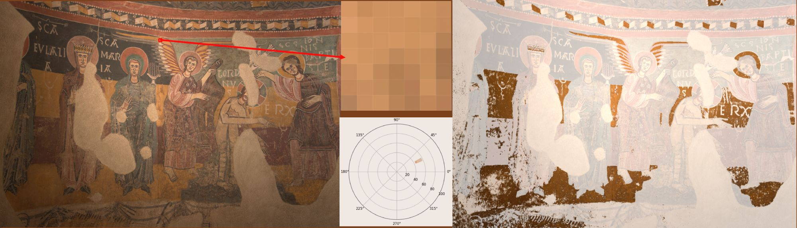

# Reflectance based segmentation
This is the official repository of:

*Reflectance-based segmentation in mural paintings: a pixel-wise
method for non-uniform lighting conditions. Martinez-Navarro, B.; Munoz-Pandiella, I.; Bosch, C.; Andujar, C. Journal on Computing and Cultural Heritage. 2026.


Image of *Santa Eulàlia d'Estaon* absis, in the *Museu Nacional d'Art de Catalunya*.

## Overview
This repository contains the source code and datasets used to evaluate our reflectance-based segmentation method, designed specifically for non-uniform illumination conditions. It also includes the code and datasets for the baseline methods used for comparison. All methods are applied to two distinct image datasets: a custom-built test scene created specifically for this experiment and real-world Romanesque mural paintings captured under museum conditions.


## Repository Organization

```text
repo-root/
│
├── Mural_paintings/   
│   └── .../          # Code to segment reflectance on example images of mural paintings
│
├── test - scene S2/  
│   └── ...              # Code to segment reflectance on the test images of scene S2
│
├── requirements.txt/  
│   └── ...              # Requirements to run de code  
│
└── README.md            # This file
```

## Implemented methods

The following segmentation approaches are implemented and evaluated in this project:

- Our poposed method: it identifies pixels sharing the same reflectance as a region of interest, independently of shading, providing a robust tool to select, analyze, or edit regions of similar reflectance. It is based on the analysis of chromaticity variations under different light intensities across various image processing pipelines

- Single pixel classifiers: Nearest Neighbors, Naive Bayes, Decision Tree, RBF-SVM, all adapted from the official "Classifier comparison" example in scikit-learn.Original Code Authors: Gaël Varoquaux and Andreas Müller; modified for documentation by Jaques Grobler.

- Fuzzy C-Means (FCM): A fuzzy clustering algorithm for soft image segmentation.

- Gaussian Mixture Model (GMM): a probabilistic approach for pixel classification.

- Color Invariants: a method based on color invariant descriptors as described by Salvador et al., 2004.

- Albedo-Based Segmentation: segmentation applied to albedo images generated prior to this pipeline using the two intrinsic image decomposition methods of Bell et al. (2014) and Careaga et al. (2023).

    Note: The source code for extracting these albedo images is not included in this repository. To reproduce or generate the initial albedo maps, please refer to the respective external repositories:

    Bell et al. (2014): https://github.com/seanbell/intrinsic

    Careaga en al (2023): https://github.com/compphoto/Intrinsic


## Requirements
- Python 3.9
- Python packages:

    ```text
    astropy==5.0.4
    astropy-iers-data==0.2024.1.1.0.33.39
    colormath==3.0.0
    colour-science==0.3.16
    imageio==2.9.0
    matplotlib==3.7.4
    numpy==1.26.4
    opencv-contrib-python==4.6.0.66
    openpyxl==3.1.2
    pandas==1.5.3
    scikit-image==0.19.3
    scikit-learn==1.1.2
    scipy==1.11.4
    ```


## Execution
Depending on which dataset you wish to analyze (test scene S2 or mural paintings), detailed setup instructions and execution steps can be found within each folder's README:

For instructions on the test scene S2 dataset, see test-sceneS2/README.md

For instructions on the Romanesque mural paintings, see Mural_paintings/README.md

## Acknowledgements
This work has been partially supported by the projects
PID2021-122136OB-C21 and PID2021-122136OB-C22 funded
by MCIN/AEI/ 10.13039/501100011033 and by FEDER A
way of making Europe, and by the Department of Research
and Universities of the Generalitat de Catalunya (2021 SGR
01035).

## References
E. Salvador, A. Cavallaro, and T. Ebrahimi, "Cast shadow segmentation using invariant color features," Computer Vision and Image Understanding, vol. 95, no. 2, pp. 238–259, 2004. DOI: 10.1016/j.cviu.2004.03.008

S. Bell, K. Bala, and N. Snavely, "Intrinsic Images in the Wild," ACM Transactions on Graphics (TOG), vol. 33, no. 4, art. 159, 2014. DOI: 10.1145/2601097.2601206

C. Careaga and Y. Aksoy, "Intrinsic Image Decomposition via Ordinal Shading," ACM Transactions on Graphics (TOG), vol. 43, no. 1, art. 12, 2023. DOI: 10.1145/3630750
